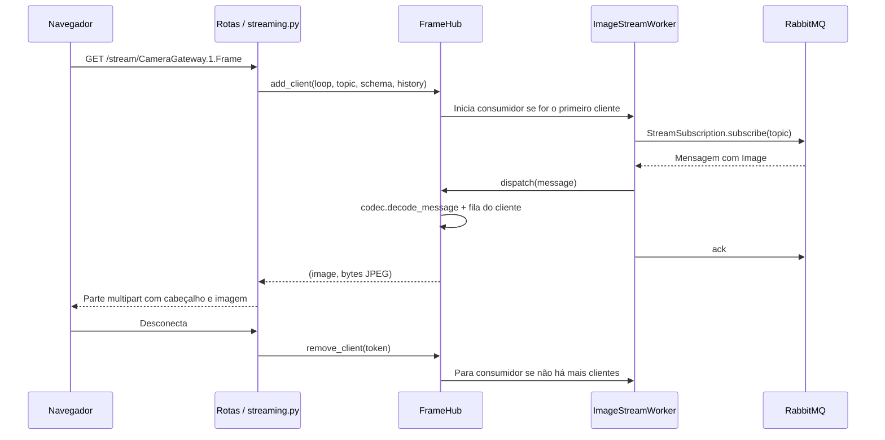

# Como o serviço funciona

Este guia acompanha o caminho das mensagens. Os nomes dos módulos representam
suas responsabilidades; não é necessário ler todos para alterar uma página ou
adicionar uma rota.

## 1. Inicialização

`server.py` expõe `app` e inicia o Uvicorn quando executado diretamente.
`is_viewer/app.py` monta o FastAPI, registra `/static` antes das rotas genéricas
e usa `lifespan` para administrar os recursos:

1. Lê `Settings`, vindo de `config.py`.
2. Abre um `RpcClient`, com canal dedicado a comandos de câmera.
3. Cria o `FrameHub`, com um canal para mensagens comuns.
4. Disponibiliza o hub e o `CameraService` em `app.state`.
5. Inicia a thread consumidora e passa a atender HTTP.
6. Ao encerrar, para o hub, os consumidores de imagem e o RPC.

Importar os módulos não abre conexões AMQP. Elas são abertas durante o startup.
`create_app(settings)` permite montar uma aplicação com configuração explícita,
inclusive nos testes.

## 2. Uma imagem chega ao navegador

A sincronização de assinaturas ocorre no loop consumidor do hub; abrir ou fechar
uma aba não altera a assinatura diretamente na thread HTTP. Imagens têm um
`ImageStreamWorker` por tópico ativo, compartilhado pelos clientes daquele tópico.
Mensagens comuns compartilham a assinatura do hub.

O serviço encaminha os bytes da imagem sem recompressão. O protocolo HTTP atual
anuncia `image/jpeg`, portanto o produtor deve enviar JPEG para esse fluxo MJPEG.

## 3. Como threads e filas se encontram

AMQP usa operações bloqueantes; os consumidores rodam em threads. FastAPI usa
um event loop assíncrono para entregar as respostas HTTP.

Cada `Client` contém campos nomeados: `loop`, `queue`, `topic` e `schema_hint`.
O hub usa um lock para acessar o registro de clientes e faz uma cópia dele antes
de distribuir uma mensagem. `loop.call_soon_threadsafe(...)` agenda a escrita na
fila dentro do event loop que a possui. Isso evita escrever em `asyncio.Queue`
a partir da thread AMQP.

Cada fila guarda de 1 a 100 mensagens, conforme `history`. Se estiver cheia, a
mais antiga é descartada antes de inserir a nova. Um navegador lento não bloqueia
os demais clientes. O `finally` do gerador HTTP remove o cliente ao terminar a
resposta, inclusive quando ela é cancelada.

Além desse limite, o consumidor de mensagens comuns drena entregas já pendentes
e mantém apenas a última por tópico. Portanto, `history=10` permite uma janela
recente de até 10 mensagens entregues; não oferece armazenamento nem reprodução
completa do histórico do broker.

## 4. Como protobuf vira JSON

`messaging/codec.py` concentra o registro de schemas e a decodificação:

1. `Json` explícito: encaminha o corpo original.
2. Schema explícito na URL ou metadata `is-schema`: procura a classe protobuf
   pelo nome curto ou completo.
3. `Image`: extrai os bytes do campo `data`.
4. Outro protobuf conhecido: usa `MessageToDict`, preservando os nomes dos
   campos, e inclui `topic`, `schema` e `message` no resultado.
5. Sem schema conhecido: tenta interpretar como `Image`; se a decodificação
   falhar, entrega tamanho e corpo em base64.

Prefira declarar o schema na URL. Protobuf não carrega o nome da mensagem no
corpo, e tentar um tipo incorreto nem sempre produz erro. O fallback não é uma
forma confiável de identificar schemas desconhecidos.

Tópicos terminados em `.Frame` são tratados como imagens pela camada HTTP.
`Json` e o nome curto `ObjectAnnotations` preservam o comportamento anterior:
retornam dados diretamente, mesmo sem `raw=1`.

## 5. Configuração e PTZ

`CameraService` conhece o contrato do CameraGateway. `RpcClient` conhece apenas
o transporte de comandos e respostas.

- `configure_camera`: transforma `fps` e `color` em `CameraConfig` e publica em
  `CameraGateway.<id>.SetConfig`, sem aguardar resposta.
- `camera_capabilities`: chama `GetCapabilities` e espera um `Struct`.
- `move_camera`: envia um `CameraConfig` e espera um `Empty`.

Publicações e RPC usam o mesmo lock no canal de comandos, separado dos canais
de consumo. O RPC valida `correlation_id` e o status da resposta. O timeout
padrão é de 3 segundos. Erros de conexão permitem uma reconexão e uma nova
tentativa; timeout não provoca repetição automática.

O valor `step_degrees / 5` escala pan, tilt e zoom. Esse nome veio da interface;
o contrato legado envia passos relativos, não uma garantia de deslocamento
físico em graus. A validação HTTP exige pelo menos um eixo diferente de zero,
eixos em `-1, 0, 1` e passo entre `0.5` e `45`.

## 6. Como as páginas são montadas

`pages.py` usa `string.Template`, da biblioteca padrão, para preencher HTML com
poucos valores. Textos e atributos dinâmicos são escapados; URLs de tópicos são
codificadas. Os fragmentos de cartões e células são gerados pelo próprio módulo.

Cada página tem arquivos com o mesmo nome em `templates/` e `static/`. Por exemplo:

- `camera.html` contém a estrutura e `camera_card.html` contém um cartão;
- `camera.css` define o estilo;
- `camera.js` consulta capacidades, salva preferências e envia PTZ.

O JavaScript lê os dados variáveis por atributos `data-*`. Não há trechos de
JavaScript interpolados em strings Python. `world3d.js` separa leitura de
anotações, projeção, desenho da grade, desenho das pessoas e interação do mouse.

Os templates são carregados e guardados em cache por processo. Reinicie o
processo após editar HTML, ou configure seu observador de arquivos para isso.
Os arquivos HTML/CSS/JS são incluídos no pacote Python e na imagem Docker.

## Onde alterar cada coisa

| Quero alterar… | Começo por… |
| --- | --- |
| Porta ou conexão com broker | `is_viewer/config.py` |
| Inicialização/encerramento | `is_viewer/app.py` |
| Uma URL ou erro HTTP | `is_viewer/web/routes.py` |
| Formato do stream HTTP | `is_viewer/web/streaming.py` |
| Novo schema protobuf | `is_viewer/messaging/codec.py` |
| Assinaturas ou descarte de mensagens | `is_viewer/messaging/hub.py` |
| Reconexão de imagens | `is_viewer/messaging/image_stream.py` |
| Comandos ou escala PTZ | `is_viewer/cameras.py` |
| Aparência/interação de uma página | `is_viewer/web/templates/` e `static/` |

Ao adicionar uma rota específica, coloque-a **antes** de `/{schema}/{topic:path}`
e `/{topic:path}`. Caso contrário, as rotas genéricas podem capturá-la.

Execute `python -m unittest discover -s tests -v` após instalar o projeto e
`httpx`, `httpx2` e `numpy`. `test_core.py` verifica o núcleo com mensagens protobuf reais e broker
simulado. `test_web.py` verifica a integração HTTP, o ciclo de vida e os streams.
Esses testes não substituem uma verificação com o broker e as câmeras do ambiente.

## Limites operacionais preservados

- Use um processo Uvicorn e uma réplica como no manifesto. Os grupos dos streams
  seguem o nome legado `cameras-visualizer.camera-<id>`; o comportamento com
  múltiplas réplicas precisa ser avaliado antes de escalar.
- O consumidor de imagens tenta reconectar. O consumidor de mensagens comuns
  encerra sua thread quando há erro de conexão; nesse caso, reinicie o serviço.
- As probes TCP verificam a porta HTTP, não o funcionamento do consumidor AMQP.
- A interface usa caminhos a partir de `/`. Hospedagem sob um prefixo de URL
  exige ajustar os caminhos ou a configuração de proxy.

## Extensões PTZ e cena estática

`web/camera_api.py` concentra as rotas de câmera e a tradução de erros RPC.
HOME usa movimento absoluto e a posição é lida de `GetConfig`; ausência de
posição gera HTTP 409, em vez de exibir zeros fictícios.

`world3d-scene.js` desenha mapa e marcadores a partir de `world3d-scene.json`.
`world3d.js` administra navegação e anotações ao vivo. O importador offline em
`scripts/import_world3d.py` faz a conversão NPZ → JSON. Veja [World3D](world3d.md).
